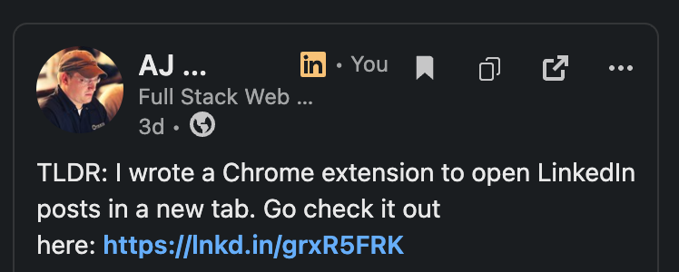
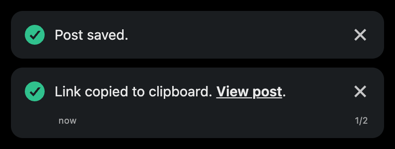
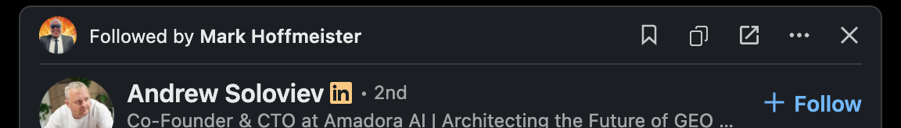
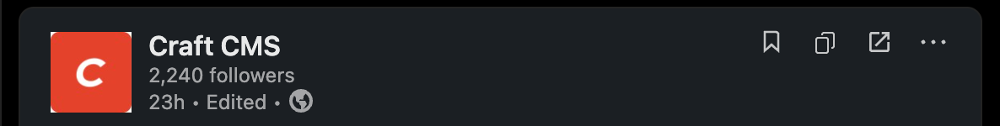
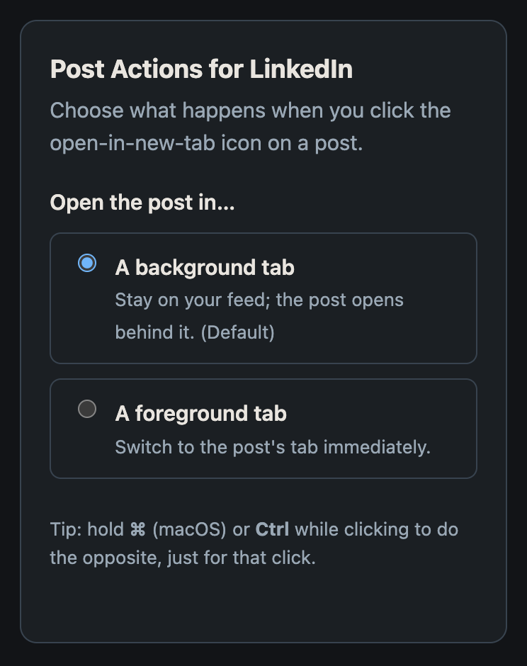

# Post Actions for LinkedIn

A tiny Chrome/Chromium extension that adds a small **quick-action toolbar** to
every LinkedIn feed post — **Save**, **Copy link**, and **Open in a new tab** —
right next to the post's `…` menu. One click each, no digging through the menu.

  
  
  
  

## Screenshots

The toolbar on a feed post (dark mode) — **Save**, **Copy link**, and **Open in a
new tab**, cloned from the post's own controls:

Hover shows LinkedIn's native hover circle:

Saved — the bookmark fills and stays filled (click again to unsave):

Because they trigger LinkedIn's own actions, Save and Copy surface LinkedIn's
**native notifications** — "Post saved." and "Link copied to clipboard.":

Works on cards with a header row, like social-proof ("Followed by …") and
"Suggested" cards:

…and on company Posts pages, which use LinkedIn's older layout:

Settings (click the toolbar icon) — open posts in a background or foreground
tab by default:

## Why

LinkedIn hides a post's most useful actions inside the `…` menu — Save, Copy
link, and getting a real permalink all take a menu click (and posts open in an
overlay, not their own page). This extension surfaces those as one-click icons
right in the post header, so you can save, copy, and fan posts out into tabs
without breaking your scroll.

## Features

- **Save** — triggers LinkedIn's own **Save action** to save the post to your
  **real LinkedIn Saved items** (not a separate list). The bookmark fills and
  stays filled; click again to unsave. On a post's own page it shows the
  already-saved state on load.
- **Copy link** — triggers LinkedIn's own **Copy link action** to copy the post's
  canonical link (the same link as *… → Copy link to post* — usually an
  `lnkd.in/…` short link).
- **Open in a new tab** — opens the post on its own page. **Background** tab by
  default; hold **⌘/Ctrl** to do the opposite for one click. Hidden on a post's
  own page, since you're already there.
- **Native everything** — each button is cloned from the post's own `…` button, so
  it matches LinkedIn's size, spacing, hover circle, and **theme color** (follows
  the in-app dark/light toggle live, no reload). And because Save and Copy fire
  LinkedIn's own menu actions, you get the real behavior — the menu is just kept
  hidden the whole time, so nothing visibly pops up.
- **Works on** — the home feed (both sorts), profiles, activity tabs (Posts,
  Comments, Reactions — yours or anyone's), search results and hashtags, groups,
  company/brand Posts pages, Saved posts, and a post's own page; including
  reposts and social-proof cards ("X likes this"). Any UI language — controls
  are matched by stable icon, not English labels.
- **Private & light** — one low-risk permission (`storage`, for your preference),
  **no host permissions**, and the extension makes **no network requests of its
  own**.

## Install

### From source (unpacked)

1. Download this repo (**Code → Download ZIP**, or the latest
   [Release](../../releases)) and unzip it.
2. Open `chrome://extensions`.
3. Toggle **Developer mode** (top-right).
4. Click **Load unpacked** and select the extension folder.
5. Open [linkedin.com/feed](https://www.linkedin.com/feed/) — each post now shows
   the Save / Copy / Open toolbar next to its `…` menu.

Works in any Chromium browser (Chrome, Edge, Brave, Arc) that supports Manifest V3.

## Settings

Open the options page from `chrome://extensions` → this extension → **Details →
Extension options** (or right-click the toolbar icon → **Options**). You can choose
whether **Open** uses a **background** tab (default) or a **foreground** tab. Hold
**⌘/Ctrl** while clicking Open to do the opposite for one click.

## How it works

- **Inject:** find each post's `…` button (by its stable `svg#overflow-web-ios-small`
  icon + `aria-label`, comment menus excluded) and insert a toolbar **cloned** from
  it; a scoped `MutationObserver` re-scans the virtualized feed.
- **Save / Copy:** programmatically click LinkedIn's own `…` menu items — matched by
  stable icon (`bookmark-*`, `link-*`), with the dropdown hidden from its first frame
  so nothing flickers. On a post's own page, Save reads its state from that menu.
- **Open:** read the share URN from the menu's Embed `href` (no clipboard) and open
  `…/feed/update/urn:li:share:<id>/` via a service-worker `chrome.tabs.create`
  (backgroundable; restricted to LinkedIn hosts), falling back to the card-derived
  permalink.

## Privacy

The extension runs only on `https://www.linkedin.com/*`, with **no host
permissions** beyond that content-script match. It makes **no network requests of
its own** and collects or transmits **no data**. Its single permission is
`storage`, used only to remember your Open background/foreground preference (via
`chrome.storage.sync`).

The Save and Copy actions work by activating LinkedIn's **own** `…` menu items on
your click: **Save** adds the post to your LinkedIn Saved items (an action on your
account, performed by LinkedIn), and **Copy link** puts the link on your
clipboard (via LinkedIn's copy control). **Open** reads the post's link from the
`…` menu's Embed reference or from the page — no clipboard access. Nothing is
sent anywhere by the extension. Full policy: [`PRIVACY.md`](PRIVACY.md).

## Project layout

| File            | Purpose                                                    |
| --------------- | ---------------------------------------------------------- |
| `manifest.json` | MV3 manifest; injects the content script on LinkedIn.      |
| `content.js`    | Builds the toolbar and drives the actions.                 |
| `background.js` | Service worker; opens the tab (background/foreground).     |
| `options.html` / `options.js` | Settings page (default Open tab behavior).   |
| `styles.css`    | Minimal button + menu-suppression styling.                 |
| `_locales/`     | UI strings (English; translation-ready via `chrome.i18n`). |
| `icons/`        | Toolbar / store icons (16, 48, 128).                       |
| `docs/`         | Screenshots for this README.                               |

## Development & limitations

- This rides LinkedIn's **private, unstable DOM**. If LinkedIn reworks the post
  header or `…` menu, detection may need a tweak — see `OVERFLOW_SELECTOR`,
  `findPostUrl`, and the `*ViaMenu` / `findSaveMenuItem` helpers in `content.js`.
  The console prints a **one-time warning** if it finds overflow menus but injects
  nothing (a signal a selector went stale).
- Save/Copy depend on the `…` menu's item **icons** (`bookmark-*`, `link-*`); if
  LinkedIn renames those, update the selectors.
- Set `DEBUG = true` at the top of `content.js` for per-post console diagnostics.
- No build step — plain MV3, edit and reload.

## License

[MIT](LICENSE) © AJ Penninga

---

*Not affiliated with, endorsed by, or sponsored by LinkedIn Corporation. "LinkedIn"
is a trademark of LinkedIn Corporation.*
