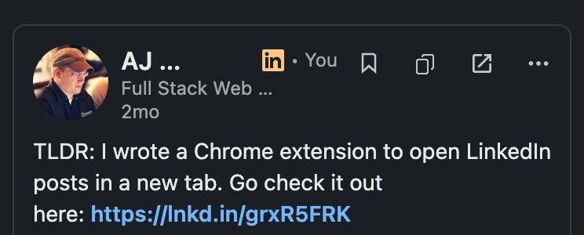
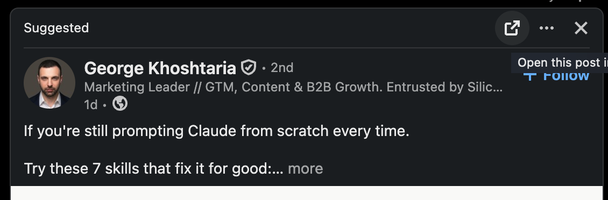
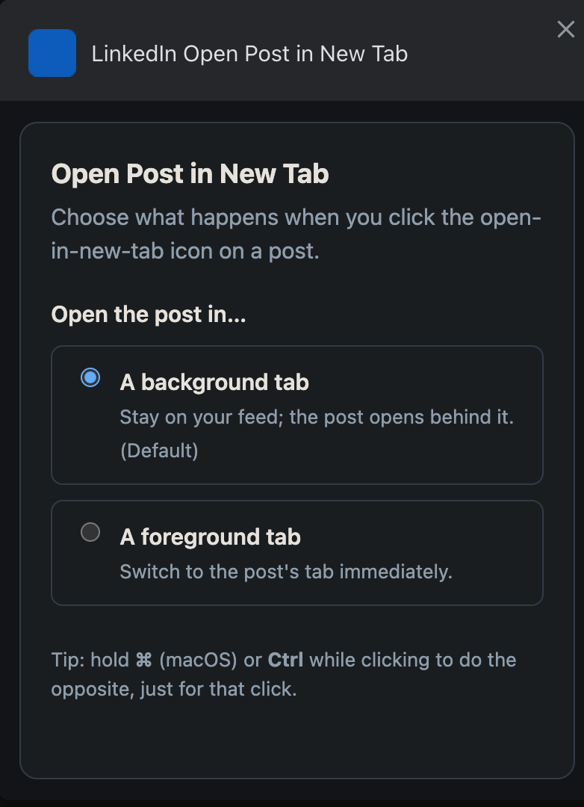
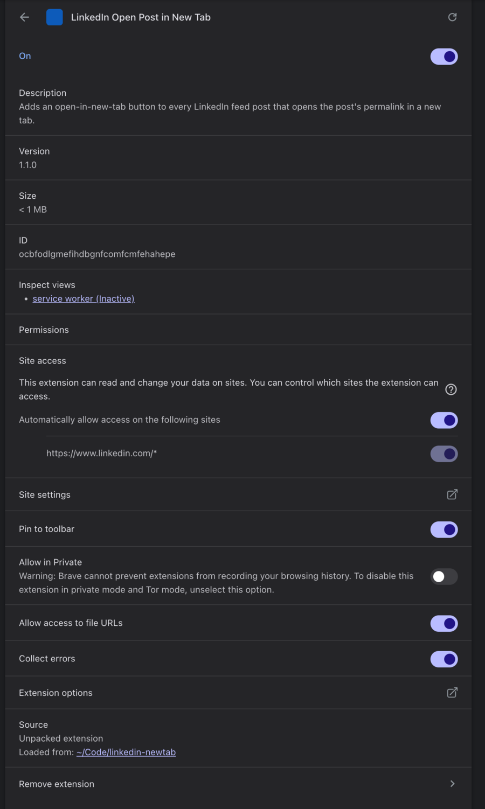

# Post Actions for LinkedIn

A tiny Chrome/Chromium extension that adds a small **quick-action toolbar** to
every LinkedIn feed post — **Save**, **Copy link**, and **Open in a new tab** —
right next to the post's `…` menu. One click each, no digging through the menu.

  
  
  
  

> **Note:** the screenshots below predate the toolbar (they show the single
> open-in-new-tab button from 1.1.x) and will be refreshed for the 1.2 release.

## Screenshots

The injected controls are cloned from the post's own `…` button, so they match
LinkedIn's size, spacing, hover circle, and theme color in both light and dark:

Choose whether posts open in a background or foreground tab — and note the
permissions: site access is limited to `linkedin.com`, with only the `storage`
permission (for your preference).

  
  &nbsp;&nbsp;
  

## Why

LinkedIn hides a post's most useful actions inside the `…` menu — Save, Copy
link, and getting a real permalink all take a menu click (and posts open in an
overlay, not their own page). This extension surfaces those as one-click icons
right in the post header, so you can save, copy, and fan posts out into tabs
without breaking your scroll.

## Features

- **Save** — saves the post to your **real LinkedIn Saved items** (not a separate
  list). The bookmark fills and stays filled; click again to unsave. On a post's
  own page it shows the already-saved state on load.
- **Copy link** — copies the post's canonical LinkedIn link (the same
  `lnkd.in/…` short link as *… → Copy link to post*).
- **Open in a new tab** — opens the post on its own page. **Background** tab by
  default; hold **⌘/Ctrl** to do the opposite for one click. Hidden on a post's
  own page, since you're already there.
- **Native look** — each button is cloned from the post's own `…` button, so it
  matches LinkedIn's size, spacing, hover circle, and **theme color** (follows the
  in-app dark/light toggle live, no reload).
- **No menu flicker** — Save and Copy work by driving LinkedIn's own `…` menu
  items, but the menu is kept hidden the whole time, so nothing visibly pops up.
- **Works across feed layouts** — home feed (both sorts), profiles, activity
  pages, reposts, and social-proof cards ("X likes this"), in any UI language
  (controls are matched by stable icon, not English labels).
- **Private & light** — one low-risk permission (`storage`, for your preference),
  **no host permissions**, and the extension makes **no network requests of its
  own**.

## Install

### From source (unpacked)

1. Download this repo (**Code → Download ZIP**, or the latest
   [Release](../../releases)) and unzip it.
2. Open `chrome://extensions`.
3. Toggle **Developer mode** (top-right).
4. Click **Load unpacked** and select the extension folder.
5. Open [linkedin.com/feed](https://www.linkedin.com/feed/) — each post now shows
   the Save / Copy / Open toolbar next to its `…` menu.

Works in any Chromium browser (Chrome, Edge, Brave, Arc) that supports Manifest V3.

## Settings

Open the options page from `chrome://extensions` → this extension → **Details →
Extension options** (or right-click the toolbar icon → **Options**). You can choose
whether **Open** uses a **background** tab (default) or a **foreground** tab. Hold
**⌘/Ctrl** while clicking Open to do the opposite for one click.

## How it works

For each post the content script finds the `…` (overflow) button — matched by its
stable `svg#overflow-web-ios-small` icon **and** localized `aria-label`, with
comment menus filtered out — and injects a toolbar of buttons **cloned** from it.
Cloning inherits LinkedIn's exact size, alignment, spacing, and hover treatment
for whatever build/layout is live, instead of chasing LinkedIn's randomized,
per-build class names. A scoped, coalesced `MutationObserver` re-scans as the
virtualized feed streams posts in.

Each action gets its link/state differently:

- **Open** reads the post's canonical share URN from the `…` menu's **Embed**
  reference (`…targetUrn=urn:li:share:<id>`), which is correct even on cards where
  the card-derived URN isn't (e.g. social-proof). It opens the hidden menu only to
  read that href — **no clipboard access** — and falls back to the card-derived
  permalink (`…/feed/update/urn:li:<type>:<id>/`, decoding the URL-encoded URN the
  main feed uses) if there's no Embed item.
- **Copy** and **Save** drive LinkedIn's own `…` menu items — matched by their
  stable icons (`link-*` for Copy link, `bookmark-*` for Save/Unsave) rather than
  localized text. The menu is opened programmatically but kept hidden (a
  `MutationObserver` hides the dropdown container from its first frame), the item
  is clicked, and the menu is dismissed — so LinkedIn performs the real action
  with no visible flicker. On a post's own permalink page, Save reads its current
  state once from that menu so an already-saved post shows filled on load.

Opening a tab is handled by a tiny **service worker** (`chrome.tabs.create`) so it
can place the tab in the background — something a content script's `window.open`
can't do — and it only ever opens LinkedIn hosts (`…/feed/update/`, `…/posts/`,
`lnkd.in/`).

## Privacy

The extension runs only on `https://www.linkedin.com/*`, with **no host
permissions** beyond that content-script match. It makes **no network requests of
its own** and collects or transmits **no data**. Its single permission is
`storage`, used only to remember your Open background/foreground preference (via
`chrome.storage.sync`).

The Save and Copy actions work by activating LinkedIn's **own** `…` menu items on
your click: **Save** adds the post to your LinkedIn Saved items (an action on your
account, performed by LinkedIn), and **Copy link** puts the link on your
clipboard (via LinkedIn's copy control). **Open** reads the post's link from the
`…` menu's Embed reference — no clipboard access. Nothing is sent anywhere by the
extension.

## Project layout

| File            | Purpose                                                    |
| --------------- | ---------------------------------------------------------- |
| `manifest.json` | MV3 manifest; injects the content script on LinkedIn.      |
| `content.js`    | Builds the toolbar and drives the actions.                 |
| `background.js` | Service worker; opens the tab (background/foreground).     |
| `options.html` / `options.js` | Settings page (default Open tab behavior).   |
| `styles.css`    | Minimal button + menu-suppression styling.                 |
| `_locales/`     | UI strings (English; translation-ready via `chrome.i18n`). |
| `icons/`        | Toolbar / store icons (16, 48, 128).                       |
| `docs/`         | Screenshots for this README.                               |

## Development & limitations

- This rides LinkedIn's **private, unstable DOM**. If LinkedIn reworks the post
  header or `…` menu, detection may need a tweak — see `OVERFLOW_SELECTOR`,
  `findPostUrl`, and the `*ViaMenu` / `findSaveMenuItem` helpers in `content.js`.
  The console prints a **one-time warning** if it finds overflow menus but injects
  nothing (a signal a selector went stale).
- Save/Copy depend on the `…` menu's item **icons** (`bookmark-*`, `link-*`); if
  LinkedIn renames those, update the selectors.
- Set `DEBUG = true` at the top of `content.js` for per-post console diagnostics.
- No build step — plain MV3, edit and reload.

## License

[MIT](LICENSE) © AJ Penninga

---

*Not affiliated with, endorsed by, or sponsored by LinkedIn Corporation. "LinkedIn"
is a trademark of LinkedIn Corporation.*
